# Fon terbaik ikut mood (dijana)

Dijana oleh `scripts/build_fonts.py` dari `data/export/fonts/`. Jangan ubah dengan tangan. Kaedah dan peraturan lesen: `README.md`.

Senarai induk: 1871 fon (fontsquirrel 119, google 1687, fontshare 65); ditolak kerana lesen berisiko: 234; fon Font Squirrel yang lesennya tidak dapat dibaca (muat turun disekat): 9.

## Berus / cat air (58 fon)

Strok berus, tulisan dicat; hidup dan artistik. Niche: Bilik tidur, Nursery, Afirmasi & motivasi, Iman / Kristian. Teks pasangan: Montserrat, Quicksand. Elak: Ayat panjang, huruf besar semua, saiz kecil.

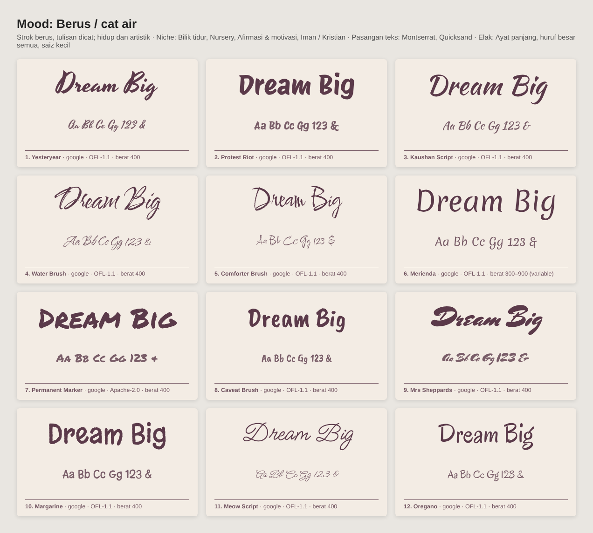

1. [Yesteryear](https://fonts.google.com/specimen/Yesteryear) · google · OFL-1.1 · ketebalan 400 · kualiti 78
2. [Protest Riot](https://fonts.google.com/specimen/Protest+Riot) · google · OFL-1.1 · ketebalan 400 · kualiti 85
3. [Kaushan Script](https://fonts.google.com/specimen/Kaushan+Script) · google · OFL-1.1 · ketebalan 400 · kualiti 76
4. [Water Brush](https://fonts.google.com/specimen/Water+Brush) · google · OFL-1.1 · ketebalan 400 · kualiti 76
5. [Comforter Brush](https://fonts.google.com/specimen/Comforter+Brush) · google · OFL-1.1 · ketebalan 400 · kualiti 74
6. [Merienda](https://fonts.google.com/specimen/Merienda) · google · OFL-1.1 · ketebalan 300–900 (variable) · kualiti 64
7. [Permanent Marker](https://fonts.google.com/specimen/Permanent+Marker) · google · Apache-2.0 · ketebalan 400 · kualiti 78
8. [Caveat Brush](https://fonts.google.com/specimen/Caveat+Brush) · google · OFL-1.1 · ketebalan 400 · kualiti 71
9. [Mrs Sheppards](https://fonts.google.com/specimen/Mrs+Sheppards) · google · OFL-1.1 · ketebalan 400 · kualiti 72
10. [Margarine](https://fonts.google.com/specimen/Margarine) · google · OFL-1.1 · ketebalan 400 · kualiti 71
11. [Meow Script](https://fonts.google.com/specimen/Meow+Script) · google · OFL-1.1 · ketebalan 400 · kualiti 71
12. [Oregano](https://fonts.google.com/specimen/Oregano) · google · OFL-1.1 · ketebalan 400 · kualiti 70

Lebih unik (luar Google Fonts): AnuDaw (semak lesen), Belligerent Madness (semak lesen), Chinese Rocks (semak lesen), Edo (semak lesen), Florante at Laura (semak lesen), Florida Vibes, Gesso (semak lesen), Gong! (semak lesen)

## Romantik / elegan (87 fon)

Script formal bersambung; anggun, majlis. Niche: Bilik tidur, Papan tanda perkahwinan, Krismas & musim cuti. Teks pasangan: Cormorant Garamond, Montserrat. Elak: Poster lucu atau gym; teks kecil.

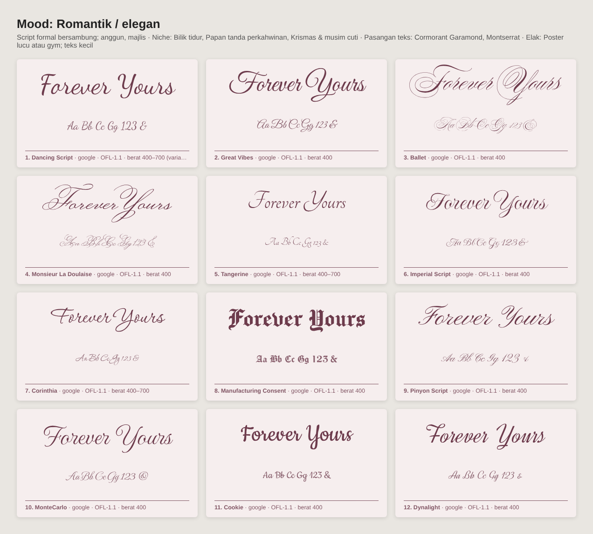

1. [Dancing Script](https://fonts.google.com/specimen/Dancing+Script) · google · OFL-1.1 · ketebalan 400–700 (variable) · kualiti 81
2. [Great Vibes](https://fonts.google.com/specimen/Great+Vibes) · google · OFL-1.1 · ketebalan 400 · kualiti 81
3. [Ballet](https://fonts.google.com/specimen/Ballet) · google · OFL-1.1 · ketebalan 400 · kualiti 84
4. [Monsieur La Doulaise](https://fonts.google.com/specimen/Monsieur+La+Doulaise) · google · OFL-1.1 · ketebalan 400 · kualiti 82
5. [Tangerine](https://fonts.google.com/specimen/Tangerine) · google · OFL-1.1 · ketebalan 400–700 · kualiti 78
6. [Imperial Script](https://fonts.google.com/specimen/Imperial+Script) · google · OFL-1.1 · ketebalan 400 · kualiti 80
7. [Corinthia](https://fonts.google.com/specimen/Corinthia) · google · OFL-1.1 · ketebalan 400–700 · kualiti 77
8. [Manufacturing Consent](https://fonts.google.com/specimen/Manufacturing+Consent) · google · OFL-1.1 · ketebalan 400 · kualiti 78
9. [Pinyon Script](https://fonts.google.com/specimen/Pinyon+Script) · google · OFL-1.1 · ketebalan 400 · kualiti 78
10. [MonteCarlo](https://fonts.google.com/specimen/MonteCarlo) · google · OFL-1.1 · ketebalan 400 · kualiti 77
11. [Cookie](https://fonts.google.com/specimen/Cookie) · google · OFL-1.1 · ketebalan 400 · kualiti 76
12. [Dynalight](https://fonts.google.com/specimen/Dynalight) · google · OFL-1.1 · ketebalan 400 · kualiti 76

Lebih unik (luar Google Fonts): Black Jack, Britney, Calligraffiti, Digory Doodles, Florante at Laura (semak lesen), Florida Vibes, Gothic Ultra OT (semak lesen), konstytucyja

Bukti: Script dinilai feminin, elegan dan menarik (Monotype Corsiva; Shaikh dkk. 2006, 561 responden) ([sumber](https://www.microsoft.com/en-us/research/uploads/prod/2021/06/Hazlett-Larson-Shaikh-Chaparo-2013-two-studies-on-how-a-typeface-congruent-with-content-can-enhance-onscreen-communication.pdf), rasmi)

Bukti: Kumpulan 'Elegance' untuk script (Brumberger 2003) ([sumber](https://understandinggraphics.com/?p=459), lemah)

## Tulisan tangan santai (192 fon)

Macam ditulis pen/marker; mesra dan peribadi. Niche: Nursery, Dapur & coffee bar, Kelas (classroom), Afirmasi & motivasi. Teks pasangan: Nunito, Lato. Elak: Poster mewah / pejabat formal.

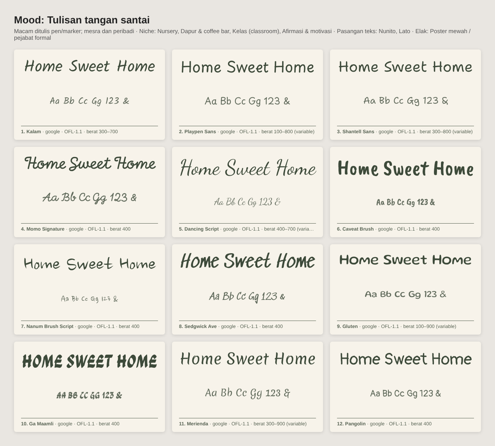

1. [Kalam](https://fonts.google.com/specimen/Kalam) · google · OFL-1.1 · ketebalan 300–700 · kualiti 74
2. [Playpen Sans](https://fonts.google.com/specimen/Playpen+Sans) · google · OFL-1.1 · ketebalan 100–800 (variable) · kualiti 82
3. [Shantell Sans](https://fonts.google.com/specimen/Shantell+Sans) · google · OFL-1.1 · ketebalan 300–800 (variable) · kualiti 85
4. [Momo Signature](https://fonts.google.com/specimen/Momo+Signature) · google · OFL-1.1 · ketebalan 400 · kualiti 95
5. [Dancing Script](https://fonts.google.com/specimen/Dancing+Script) · google · OFL-1.1 · ketebalan 400–700 (variable) · kualiti 81
6. [Caveat Brush](https://fonts.google.com/specimen/Caveat+Brush) · google · OFL-1.1 · ketebalan 400 · kualiti 71
7. [Nanum Brush Script](https://fonts.google.com/specimen/Nanum+Brush+Script) · google · OFL-1.1 · ketebalan 400 · kualiti 67
8. [Sedgwick Ave](https://fonts.google.com/specimen/Sedgwick+Ave) · google · OFL-1.1 · ketebalan 400 · kualiti 62
9. [Gluten](https://fonts.google.com/specimen/Gluten) · google · OFL-1.1 · ketebalan 100–900 (variable) · kualiti 61
10. [Ga Maamli](https://fonts.google.com/specimen/Ga+Maamli) · google · OFL-1.1 · ketebalan 400 · kualiti 82
11. [Merienda](https://fonts.google.com/specimen/Merienda) · google · OFL-1.1 · ketebalan 300–900 (variable) · kualiti 64
12. [Pangolin](https://fonts.google.com/specimen/Pangolin) · google · OFL-1.1 · ketebalan 400 · kualiti 78

Lebih unik (luar Google Fonts): Amatic, Black Jack, Brizel, Caroni, Comico, Digory Doodles, konstytucyja, League Script #1

Bukti: Fon bulat, tidak sempurna seperti tulisan tangan dinilai mesra (Mackiewicz 2005) ([sumber](https://editingresearch.byu.edu/2021/05/21/choosing-a-font-can-be-a-daunting-task-but-with-the-proper-instruction-it-doesnt-have-to-be/), lemah)

## Lucu / pelik (189 fon)

Bentuk melantun, tidak sekata; humor. Niche: Bilik air (lucu), Dapur & coffee bar, Bilik dobi, Bilik anak & playroom. Teks pasangan: Poppins, Nunito. Elak: Mesej serius, duka, keagamaan.

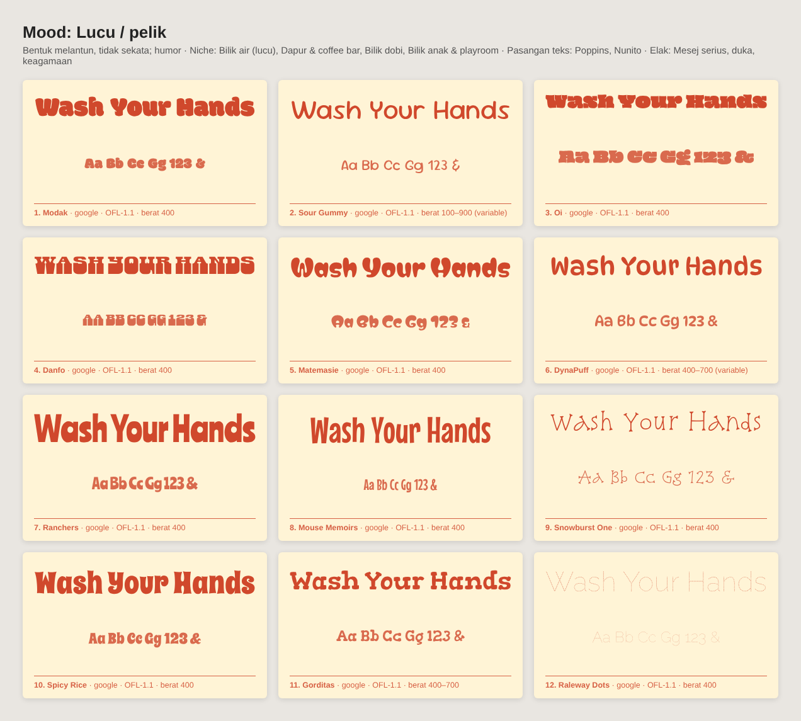

1. [Modak](https://fonts.google.com/specimen/Modak) · google · OFL-1.1 · ketebalan 400 · kualiti 85
2. [Sour Gummy](https://fonts.google.com/specimen/Sour+Gummy) · google · OFL-1.1 · ketebalan 100–900 (variable) · kualiti 69
3. [Oi](https://fonts.google.com/specimen/Oi) · google · OFL-1.1 · ketebalan 400 · kualiti 89
4. [Danfo](https://fonts.google.com/specimen/Danfo) · google · OFL-1.1 · ketebalan 400 · kualiti 85
5. [Matemasie](https://fonts.google.com/specimen/Matemasie) · google · OFL-1.1 · ketebalan 400 · kualiti 84
6. [DynaPuff](https://fonts.google.com/specimen/DynaPuff) · google · OFL-1.1 · ketebalan 400–700 (variable) · kualiti 74
7. [Ranchers](https://fonts.google.com/specimen/Ranchers) · google · OFL-1.1 · ketebalan 400 · kualiti 80
8. [Mouse Memoirs](https://fonts.google.com/specimen/Mouse+Memoirs) · google · OFL-1.1 · ketebalan 400 · kualiti 78
9. [Snowburst One](https://fonts.google.com/specimen/Snowburst+One) · google · OFL-1.1 · ketebalan 400 · kualiti 78
10. [Spicy Rice](https://fonts.google.com/specimen/Spicy+Rice) · google · OFL-1.1 · ketebalan 400 · kualiti 78
11. [Gorditas](https://fonts.google.com/specimen/Gorditas) · google · OFL-1.1 · ketebalan 400–700 · kualiti 70
12. [Raleway Dots](https://fonts.google.com/specimen/Raleway+Dots) · google · OFL-1.1 · ketebalan 400 · kualiti 72

Lebih unik (luar Google Fonts): 3Dumb (semak lesen), AnuDaw (semak lesen), Chubbo, Comic Zine (semak lesen), Comico, Impact Label (semak lesen), Pally, Paquito

Bukti: Faktor personaliti tersendiri 'Script/Funny' (Shaikh dkk. 2006) ([sumber](https://www.microsoft.com/en-us/research/uploads/prod/2021/06/Hazlett-Larson-Shaikh-Chaparo-2013-two-studies-on-how-a-typeface-congruent-with-content-can-enhance-onscreen-communication.pdf), rasmi)

## Kanak-kanak / comel (160 fon)

Bulat, tebal lembut; ceria. Niche: Nursery, Kelas (classroom), Bilik anak & playroom. Teks pasangan: Quicksand, Nunito. Elak: Pejabat, gym, mewah.

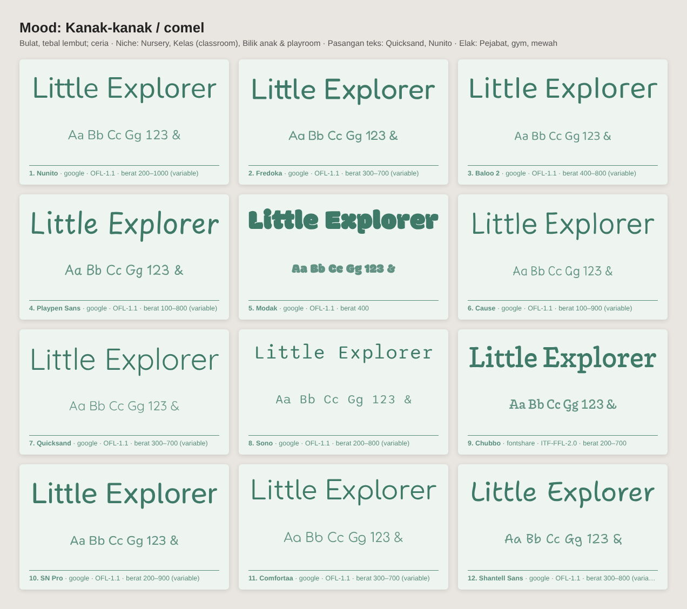

1. [Nunito](https://fonts.google.com/specimen/Nunito) · google · OFL-1.1 · ketebalan 200–1000 (variable) · kualiti 76
2. [Fredoka](https://fonts.google.com/specimen/Fredoka) · google · OFL-1.1 · ketebalan 300–700 (variable) · kualiti 77
3. [Baloo 2](https://fonts.google.com/specimen/Baloo+2) · google · OFL-1.1 · ketebalan 400–800 (variable) · kualiti 75
4. [Playpen Sans](https://fonts.google.com/specimen/Playpen+Sans) · google · OFL-1.1 · ketebalan 100–800 (variable) · kualiti 82
5. [Modak](https://fonts.google.com/specimen/Modak) · google · OFL-1.1 · ketebalan 400 · kualiti 85
6. [Cause](https://fonts.google.com/specimen/Cause) · google · OFL-1.1 · ketebalan 100–900 (variable) · kualiti 72
7. [Quicksand](https://fonts.google.com/specimen/Quicksand) · google · OFL-1.1 · ketebalan 300–700 (variable) · kualiti 71
8. [Sono](https://fonts.google.com/specimen/Sono) · google · OFL-1.1 · ketebalan 200–800 (variable) · kualiti 80
9. [Chubbo](https://www.fontshare.com/fonts/chubbo) · fontshare · ITF-FFL-2.0 · ketebalan 200–700
10. [SN Pro](https://fonts.google.com/specimen/SN+Pro) · google · OFL-1.1 · ketebalan 200–900 (variable) · kualiti 76
11. [Comfortaa](https://fonts.google.com/specimen/Comfortaa) · google · OFL-1.1 · ketebalan 300–700 (variable) · kualiti 65
12. [Shantell Sans](https://fonts.google.com/specimen/Shantell+Sans) · google · OFL-1.1 · ketebalan 300–800 (variable) · kualiti 85

Lebih unik (luar Google Fonts): Pally, Paquito

Bukti: Fon bulat dipadankan dengan 'manis' (Velasco dkk. 2015) ([sumber](https://pmc.ncbi.nlm.nih.gov/articles/PMC4934647), lemah)

## Lembut / tenang (78 fon)

Ringan, terbuka, jarak lapang; boho, kaunselor. Niche: Bilik kaunselor / calm corner, Afirmasi & motivasi, Bilik tidur, Iman / Kristian. Teks pasangan: Quicksand, Cormorant Garamond. Elak: Humor kuat, motivasi agresif.

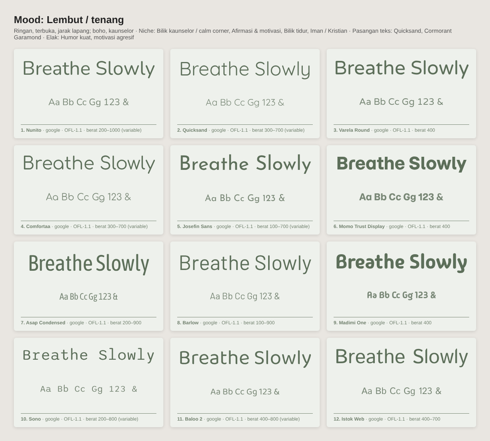

1. [Nunito](https://fonts.google.com/specimen/Nunito) · google · OFL-1.1 · ketebalan 200–1000 (variable) · kualiti 76
2. [Quicksand](https://fonts.google.com/specimen/Quicksand) · google · OFL-1.1 · ketebalan 300–700 (variable) · kualiti 71
3. [Varela Round](https://fonts.google.com/specimen/Varela+Round) · google · OFL-1.1 · ketebalan 400 · kualiti 80
4. [Comfortaa](https://fonts.google.com/specimen/Comfortaa) · google · OFL-1.1 · ketebalan 300–700 (variable) · kualiti 65
5. [Josefin Sans](https://fonts.google.com/specimen/Josefin+Sans) · google · OFL-1.1 · ketebalan 100–700 (variable) · kualiti 62
6. [Momo Trust Display](https://fonts.google.com/specimen/Momo+Trust+Display) · google · OFL-1.1 · ketebalan 400 · kualiti 81
7. [Asap Condensed](https://fonts.google.com/specimen/Asap+Condensed) · google · OFL-1.1 · ketebalan 200–900 · kualiti 78
8. [Barlow](https://fonts.google.com/specimen/Barlow) · google · OFL-1.1 · ketebalan 100–900 · kualiti 72
9. [Madimi One](https://fonts.google.com/specimen/Madimi+One) · google · OFL-1.1 · ketebalan 400 · kualiti 71
10. [Sono](https://fonts.google.com/specimen/Sono) · google · OFL-1.1 · ketebalan 200–800 (variable) · kualiti 80
11. [Baloo 2](https://fonts.google.com/specimen/Baloo+2) · google · OFL-1.1 · ketebalan 400–800 (variable) · kualiti 75
12. [Istok Web](https://fonts.google.com/specimen/Istok+Web) · google · OFL-1.1 · ketebalan 400–700 · kualiti 67

Bukti: Fon lembut beri respons positif lebih tinggi; fon tajam cetus emosi negatif (Monotype × Neurons 2021, kajian vendor) ([sumber](https://www.monotype.com/resources/can-fonts-affect-our-feelings), lemah)

## Kuat / motivasi (29 fon)

Tebal, sempit (condensed), lantang. Niche: Home gym, Home office & cubicle, Asrama / dorm, Bilik remaja. Teks pasangan: Inter, Roboto Condensed. Elak: Script halus; poster tidur/nursery.

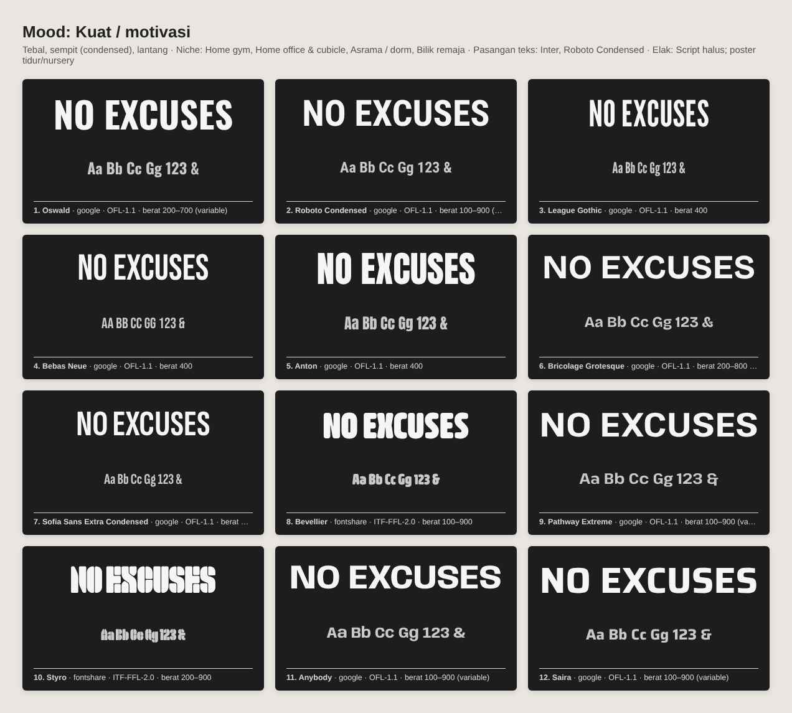

1. [Oswald](https://fonts.google.com/specimen/Oswald) · google · OFL-1.1 · ketebalan 200–700 (variable) · kualiti 84
2. [Roboto Condensed](https://fonts.google.com/specimen/Roboto+Condensed) · google · OFL-1.1 · ketebalan 100–900 (variable) · kualiti 80
3. [League Gothic](https://fonts.google.com/specimen/League+Gothic) · google · OFL-1.1 · ketebalan 400 · kualiti 82
4. [Bebas Neue](https://fonts.google.com/specimen/Bebas+Neue) · google · OFL-1.1 · ketebalan 400 · kualiti 81
5. [Anton](https://fonts.google.com/specimen/Anton) · google · OFL-1.1 · ketebalan 400 · kualiti 70
6. [Bricolage Grotesque](https://fonts.google.com/specimen/Bricolage+Grotesque) · google · OFL-1.1 · ketebalan 200–800 (variable) · kualiti 82
7. [Sofia Sans Extra Condensed](https://fonts.google.com/specimen/Sofia+Sans+Extra+Condensed) · google · OFL-1.1 · ketebalan 1–1000 (variable) · kualiti 76
8. [Bevellier](https://www.fontshare.com/fonts/bevellier) · fontshare · ITF-FFL-2.0 · ketebalan 100–900
9. [Pathway Extreme](https://fonts.google.com/specimen/Pathway+Extreme) · google · OFL-1.1 · ketebalan 100–900 (variable) · kualiti 68
10. [Styro](https://www.fontshare.com/fonts/styro) · fontshare · ITF-FFL-2.0 · ketebalan 200–900
11. [Anybody](https://fonts.google.com/specimen/Anybody) · google · OFL-1.1 · ketebalan 100–900 (variable) · kualiti 74
12. [Saira](https://fonts.google.com/specimen/Saira) · google · OFL-1.1 · ketebalan 100–900 (variable) · kualiti 78

Lebih unik (luar Google Fonts): Boxing, Capture it (semak lesen), Kihim, New Title, Nippo, Post No Bills, Sharpie, Top Secret (semak lesen)

Bukti: Tiada kajian langsung 'condensed tebal = motivasi'; tag Google beri skor Loud tinggi untuk fon condensed tebal ([sumber](https://github.com/google/fonts/blob/main/tags/all/README.md), lemah)

## Retro / groovy 60–70an (188 fon)

Gemuk, melengkung, berbayang/inline. Niche: Kelas (classroom), Dapur & coffee bar, Asrama / dorm, Bilik air (lucu). Teks pasangan: DM Sans, Work Sans. Elak: Minimalis moden, mewah.

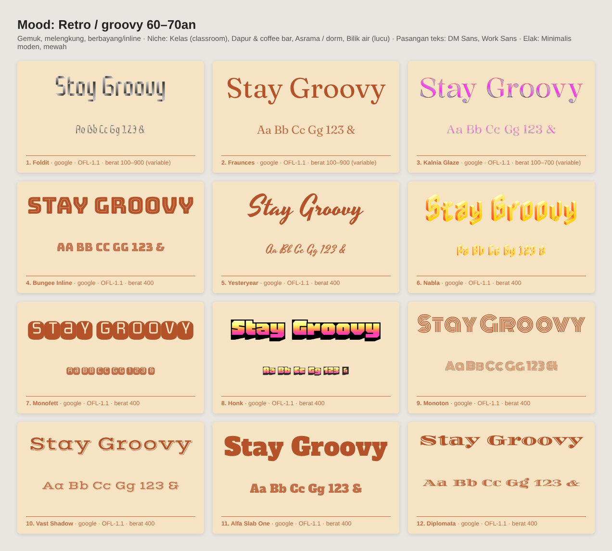

1. [Foldit](https://fonts.google.com/specimen/Foldit) · google · OFL-1.1 · ketebalan 100–900 (variable) · kualiti 86
2. [Fraunces](https://fonts.google.com/specimen/Fraunces) · google · OFL-1.1 · ketebalan 100–900 (variable) · kualiti 78
3. [Kalnia Glaze](https://fonts.google.com/specimen/Kalnia+Glaze) · google · OFL-1.1 · ketebalan 100–700 (variable) · kualiti 76
4. [Bungee Inline](https://fonts.google.com/specimen/Bungee+Inline) · google · OFL-1.1 · ketebalan 400 · kualiti 90
5. [Yesteryear](https://fonts.google.com/specimen/Yesteryear) · google · OFL-1.1 · ketebalan 400 · kualiti 78
6. [Nabla](https://fonts.google.com/specimen/Nabla) · google · OFL-1.1 · ketebalan 400 · kualiti 85
7. [Monofett](https://fonts.google.com/specimen/Monofett) · google · OFL-1.1 · ketebalan 400 · kualiti 84
8. [Honk](https://fonts.google.com/specimen/Honk) · google · OFL-1.1 · ketebalan 400 · kualiti 81
9. [Monoton](https://fonts.google.com/specimen/Monoton) · google · OFL-1.1 · ketebalan 400 · kualiti 80
10. [Vast Shadow](https://fonts.google.com/specimen/Vast+Shadow) · google · OFL-1.1 · ketebalan 400 · kualiti 80
11. [Alfa Slab One](https://fonts.google.com/specimen/Alfa+Slab+One) · google · OFL-1.1 · ketebalan 400 · kualiti 71
12. [Diplomata](https://fonts.google.com/specimen/Diplomata) · google · OFL-1.1 · ketebalan 400 · kualiti 78

Lebih unik (luar Google Fonts): Bonny, Boxing, Britney, Intro Rust (semak lesen), Striper

## Klasik / akademik (195 fon)

Serif buku tradisional; ilmu, sastera. Niche: Reading nook & bookish, Home office & cubicle, Iman / Kristian. Teks pasangan: Lato, Source Sans 3. Elak: Kanak-kanak, humor.

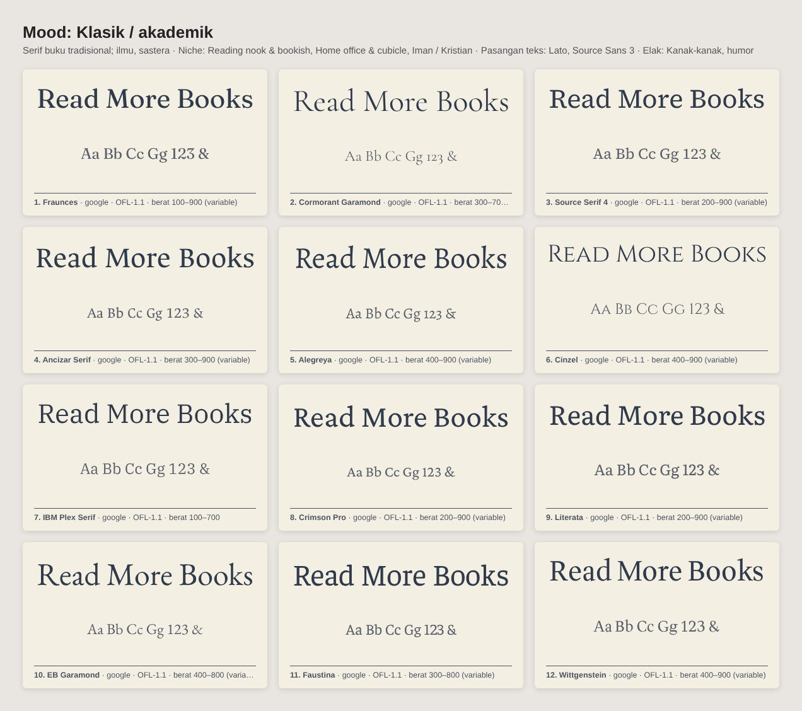

1. [Fraunces](https://fonts.google.com/specimen/Fraunces) · google · OFL-1.1 · ketebalan 100–900 (variable) · kualiti 78
2. [Cormorant Garamond](https://fonts.google.com/specimen/Cormorant+Garamond) · google · OFL-1.1 · ketebalan 300–700 (variable) · kualiti 76
3. [Source Serif 4](https://fonts.google.com/specimen/Source+Serif+4) · google · OFL-1.1 · ketebalan 200–900 (variable) · kualiti 85
4. [Ancizar Serif](https://fonts.google.com/specimen/Ancizar+Serif) · google · OFL-1.1 · ketebalan 300–900 (variable) · kualiti 80
5. [Alegreya](https://fonts.google.com/specimen/Alegreya) · google · OFL-1.1 · ketebalan 400–900 (variable) · kualiti 82
6. [Cinzel](https://fonts.google.com/specimen/Cinzel) · google · OFL-1.1 · ketebalan 400–900 (variable) · kualiti 82
7. [IBM Plex Serif](https://fonts.google.com/specimen/IBM+Plex+Serif) · google · OFL-1.1 · ketebalan 100–700 · kualiti 78
8. [Crimson Pro](https://fonts.google.com/specimen/Crimson+Pro) · google · OFL-1.1 · ketebalan 200–900 (variable) · kualiti 75
9. [Literata](https://fonts.google.com/specimen/Literata) · google · OFL-1.1 · ketebalan 200–900 (variable) · kualiti 75
10. [EB Garamond](https://fonts.google.com/specimen/EB+Garamond) · google · OFL-1.1 · ketebalan 400–800 (variable) · kualiti 79
11. [Faustina](https://fonts.google.com/specimen/Faustina) · google · OFL-1.1 · ketebalan 300–800 (variable) · kualiti 76
12. [Wittgenstein](https://fonts.google.com/specimen/Wittgenstein) · google · OFL-1.1 · ketebalan 400–900 (variable) · kualiti 75

Lebih unik (luar Google Fonts): Bespoke Serif, Erode, Gambetta, Neco, Recia, Rowan, Sears Tower (semak lesen), Secret Typewriter (semak lesen)

Bukti: Serif (Times New Roman) dinilai stabil, matang, praktikal; Georgia formal (Shaikh dkk. 2006) ([sumber](https://www.microsoft.com/en-us/research/uploads/prod/2021/06/Hazlett-Larson-Shaikh-Chaparo-2013-two-studies-on-how-a-typeface-congruent-with-content-can-enhance-onscreen-communication.pdf), rasmi)

## Mewah / Art Deco (79 fon)

Kontras tinggi (Didone), geometri Deco. Niche: Bilik air (lucu), Home office & cubicle, Ruang tamu. Teks pasangan: Montserrat, Josefin Sans. Elak: Kanak-kanak, grunge.

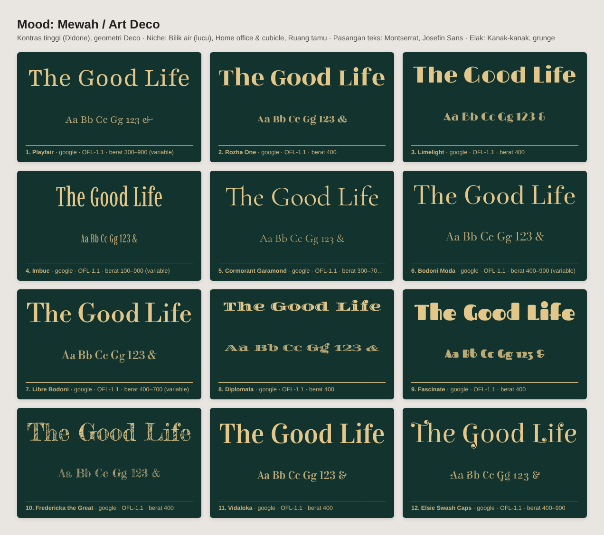

1. [Playfair](https://fonts.google.com/specimen/Playfair) · google · OFL-1.1 · ketebalan 300–900 (variable) · kualiti 88
2. [Rozha One](https://fonts.google.com/specimen/Rozha+One) · google · OFL-1.1 · ketebalan 400 · kualiti 78
3. [Limelight](https://fonts.google.com/specimen/Limelight) · google · OFL-1.1 · ketebalan 400 · kualiti 75
4. [Imbue](https://fonts.google.com/specimen/Imbue) · google · OFL-1.1 · ketebalan 100–900 (variable) · kualiti 71
5. [Cormorant Garamond](https://fonts.google.com/specimen/Cormorant+Garamond) · google · OFL-1.1 · ketebalan 300–700 (variable) · kualiti 76
6. [Bodoni Moda](https://fonts.google.com/specimen/Bodoni+Moda) · google · OFL-1.1 · ketebalan 400–900 (variable) · kualiti 70
7. [Libre Bodoni](https://fonts.google.com/specimen/Libre+Bodoni) · google · OFL-1.1 · ketebalan 400–700 (variable) · kualiti 75
8. [Diplomata](https://fonts.google.com/specimen/Diplomata) · google · OFL-1.1 · ketebalan 400 · kualiti 78
9. [Fascinate](https://fonts.google.com/specimen/Fascinate) · google · OFL-1.1 · ketebalan 400 · kualiti 76
10. [Fredericka the Great](https://fonts.google.com/specimen/Fredericka+the+Great) · google · OFL-1.1 · ketebalan 400 · kualiti 75
11. [Vidaloka](https://fonts.google.com/specimen/Vidaloka) · google · OFL-1.1 · ketebalan 400 · kualiti 75
12. [Elsie Swash Caps](https://fonts.google.com/specimen/Elsie+Swash+Caps) · google · OFL-1.1 · ketebalan 400–900 · kualiti 70

Lebih unik (luar Google Fonts): Bonny, Boska, Gambarino, Melodrama, Stardom, Zina

## Rustik / farmhouse / western (96 fon)

Slab kayu, tanda kedai lama. Niche: Bilik dobi, Dapur & coffee bar, Pintu masuk & mudroom, Ruang makan. Teks pasangan: Lato, Josefin Sans. Elak: Mewah moden, futuristik.

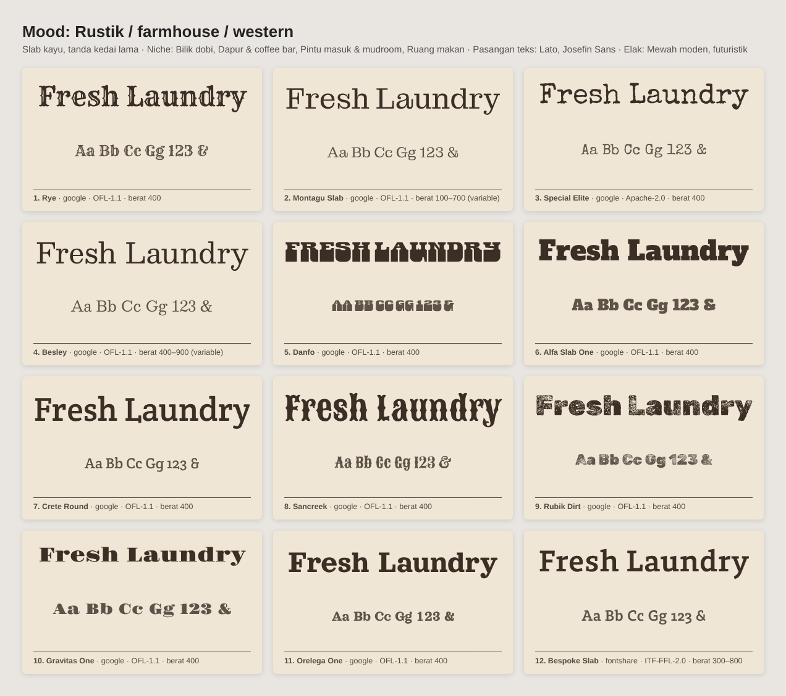

1. [Rye](https://fonts.google.com/specimen/Rye) · google · OFL-1.1 · ketebalan 400 · kualiti 75
2. [Montagu Slab](https://fonts.google.com/specimen/Montagu+Slab) · google · OFL-1.1 · ketebalan 100–700 (variable) · kualiti 71
3. [Special Elite](https://fonts.google.com/specimen/Special+Elite) · google · Apache-2.0 · ketebalan 400 · kualiti 88
4. [Besley](https://fonts.google.com/specimen/Besley) · google · OFL-1.1 · ketebalan 400–900 (variable) · kualiti 72
5. [Danfo](https://fonts.google.com/specimen/Danfo) · google · OFL-1.1 · ketebalan 400 · kualiti 85
6. [Alfa Slab One](https://fonts.google.com/specimen/Alfa+Slab+One) · google · OFL-1.1 · ketebalan 400 · kualiti 71
7. [Crete Round](https://fonts.google.com/specimen/Crete+Round) · google · OFL-1.1 · ketebalan 400 · kualiti 76
8. [Sancreek](https://fonts.google.com/specimen/Sancreek) · google · OFL-1.1 · ketebalan 400 · kualiti 74
9. [Rubik Dirt](https://fonts.google.com/specimen/Rubik+Dirt) · google · OFL-1.1 · ketebalan 400 · kualiti 72
10. [Gravitas One](https://fonts.google.com/specimen/Gravitas+One) · google · OFL-1.1 · ketebalan 400 · kualiti 70
11. [Orelega One](https://fonts.google.com/specimen/Orelega+One) · google · OFL-1.1 · ketebalan 400 · kualiti 70
12. [Bespoke Slab](https://www.fontshare.com/fonts/bespoke-slab) · fontshare · ITF-FFL-2.0 · ketebalan 300–800

Lebih unik (luar Google Fonts): Bodonitown (semak lesen), Fin Serif Display, Gaspar, Gawaa, Hjet, Hoover, Minipax, Paquito

## Gotik / medieval (33 fon)

Blackletter, gaya manuskrip. Niche: Krismas & musim cuti, Halloween, Thanksgiving, Easter, Reading nook & bookish. Teks pasangan: EB Garamond, Cormorant. Elak: Ayat panjang; kanak-kanak.

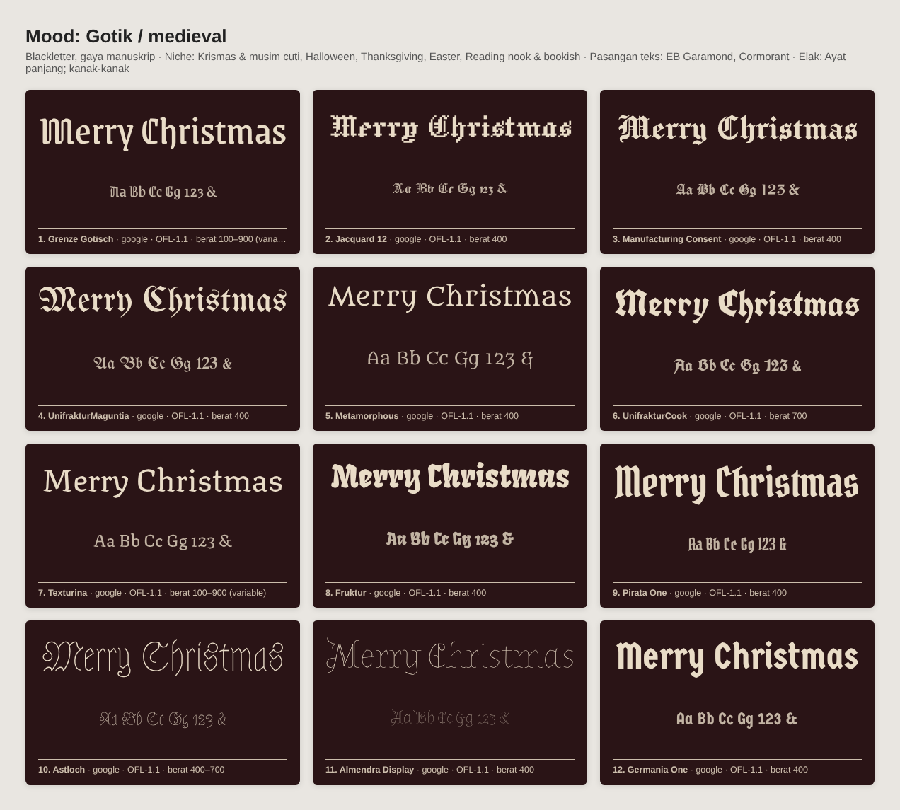

1. [Grenze Gotisch](https://fonts.google.com/specimen/Grenze+Gotisch) · google · OFL-1.1 · ketebalan 100–900 (variable) · kualiti 72
2. [Jacquard 12](https://fonts.google.com/specimen/Jacquard+12) · google · OFL-1.1 · ketebalan 400 · kualiti 85
3. [Manufacturing Consent](https://fonts.google.com/specimen/Manufacturing+Consent) · google · OFL-1.1 · ketebalan 400 · kualiti 78
4. [UnifrakturMaguntia](https://fonts.google.com/specimen/UnifrakturMaguntia) · google · OFL-1.1 · ketebalan 400 · kualiti 71
5. [Metamorphous](https://fonts.google.com/specimen/Metamorphous) · google · OFL-1.1 · ketebalan 400 · kualiti 69
6. [UnifrakturCook](https://fonts.google.com/specimen/UnifrakturCook) · google · OFL-1.1 · ketebalan 700 · kualiti 68
7. [Texturina](https://fonts.google.com/specimen/Texturina) · google · OFL-1.1 · ketebalan 100–900 (variable) · kualiti 76
8. [Fruktur](https://fonts.google.com/specimen/Fruktur) · google · OFL-1.1 · ketebalan 400 · kualiti 83
9. [Pirata One](https://fonts.google.com/specimen/Pirata+One) · google · OFL-1.1 · ketebalan 400 · kualiti 65
10. [Astloch](https://fonts.google.com/specimen/Astloch) · google · OFL-1.1 · ketebalan 400–700 · kualiti 62
11. [Almendra Display](https://fonts.google.com/specimen/Almendra+Display) · google · OFL-1.1 · ketebalan 400 · kualiti 64
12. [Germania One](https://fonts.google.com/specimen/Germania+One) · google · OFL-1.1 · ketebalan 400 · kualiti 61

Lebih unik (luar Google Fonts): Aktura, Balgruf, Chomsky, KJV1611, Quaerite Regnum Dei, Trickster, Unifraktur Maguntia

## Seram / Halloween (43 fon)

Menitis, retak, menakutkan. Niche: Halloween, Thanksgiving, Easter. Teks pasangan: Oswald, Bebas Neue. Elak: Semua niche lain.

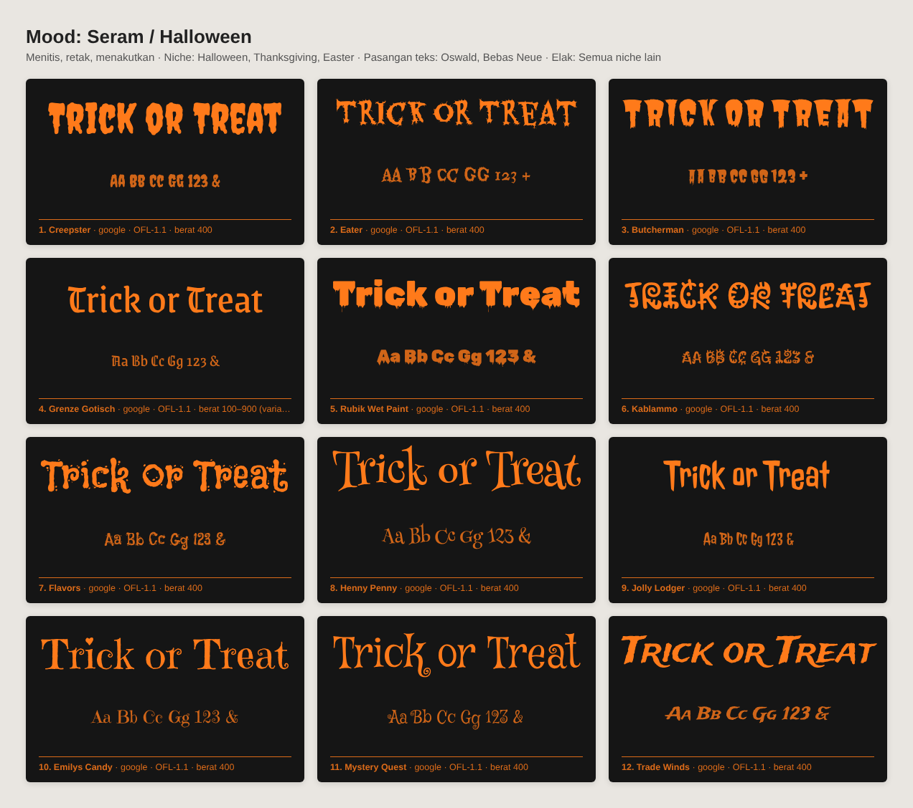

1. [Creepster](https://fonts.google.com/specimen/Creepster) · google · OFL-1.1 · ketebalan 400 · kualiti 82
2. [Eater](https://fonts.google.com/specimen/Eater) · google · OFL-1.1 · ketebalan 400 · kualiti 66
3. [Butcherman](https://fonts.google.com/specimen/Butcherman) · google · OFL-1.1 · ketebalan 400 · kualiti 60
4. [Grenze Gotisch](https://fonts.google.com/specimen/Grenze+Gotisch) · google · OFL-1.1 · ketebalan 100–900 (variable) · kualiti 72
5. [Rubik Wet Paint](https://fonts.google.com/specimen/Rubik+Wet+Paint) · google · OFL-1.1 · ketebalan 400 · kualiti 71
6. [Kablammo](https://fonts.google.com/specimen/Kablammo) · google · OFL-1.1 · ketebalan 400 · kualiti 91
7. [Flavors](https://fonts.google.com/specimen/Flavors) · google · OFL-1.1 · ketebalan 400 · kualiti 68
8. [Henny Penny](https://fonts.google.com/specimen/Henny+Penny) · google · OFL-1.1 · ketebalan 400 · kualiti 68
9. [Jolly Lodger](https://fonts.google.com/specimen/Jolly+Lodger) · google · OFL-1.1 · ketebalan 400 · kualiti 68
10. [Emilys Candy](https://fonts.google.com/specimen/Emilys+Candy) · google · OFL-1.1 · ketebalan 400 · kualiti 66
11. [Mystery Quest](https://fonts.google.com/specimen/Mystery+Quest) · google · OFL-1.1 · ketebalan 400 · kualiti 60
12. [Trade Winds](https://fonts.google.com/specimen/Trade+Winds) · google · OFL-1.1 · ketebalan 400 · kualiti 70

## Kasar / grunge (117 fon)

Tekstur rosak, stensil, kasar. Niche: Bilik remaja, Asrama / dorm, Man cave, garaj & bar, Home gym. Teks pasangan: Oswald, Inter. Elak: Nursery, perkahwinan.

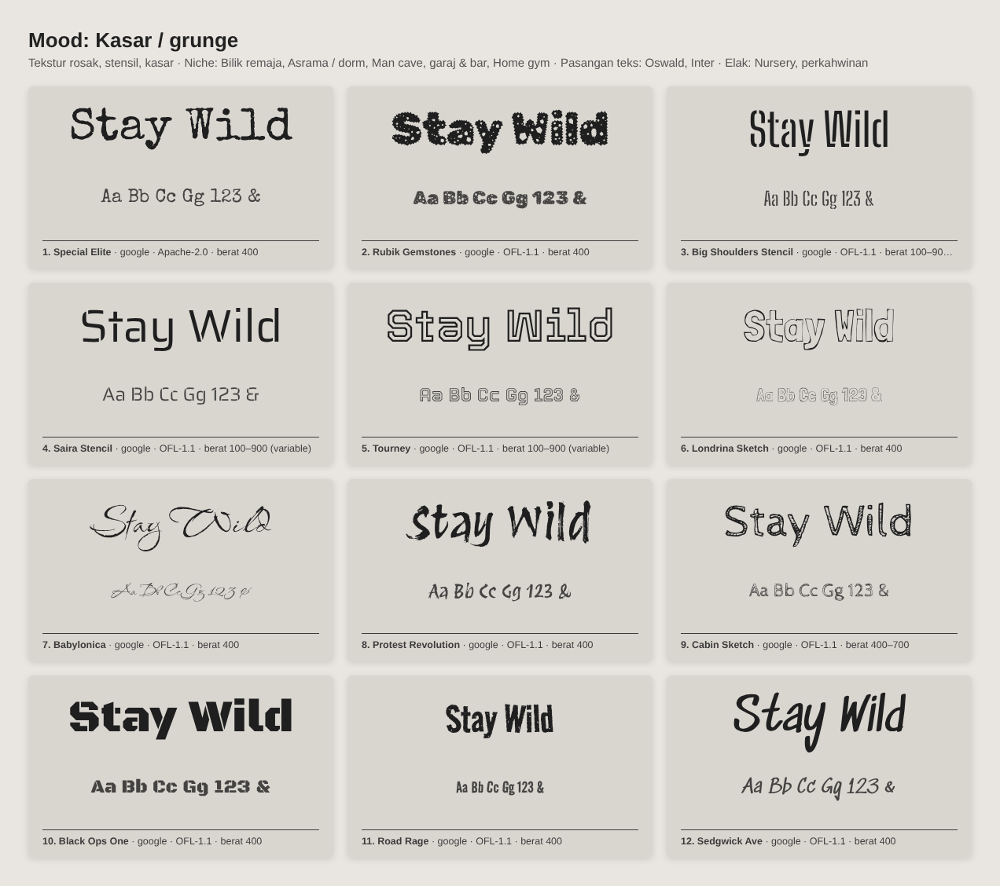

1. [Special Elite](https://fonts.google.com/specimen/Special+Elite) · google · Apache-2.0 · ketebalan 400 · kualiti 88
2. [Rubik Gemstones](https://fonts.google.com/specimen/Rubik+Gemstones) · google · OFL-1.1 · ketebalan 400 · kualiti 79
3. [Big Shoulders Stencil](https://fonts.google.com/specimen/Big+Shoulders+Stencil) · google · OFL-1.1 · ketebalan 100–900 (variable) · kualiti 70
4. [Saira Stencil](https://fonts.google.com/specimen/Saira+Stencil) · google · OFL-1.1 · ketebalan 100–900 (variable)
5. [Tourney](https://fonts.google.com/specimen/Tourney) · google · OFL-1.1 · ketebalan 100–900 (variable) · kualiti 68
6. [Londrina Sketch](https://fonts.google.com/specimen/Londrina+Sketch) · google · OFL-1.1 · ketebalan 400 · kualiti 72
7. [Babylonica](https://fonts.google.com/specimen/Babylonica) · google · OFL-1.1 · ketebalan 400 · kualiti 70
8. [Protest Revolution](https://fonts.google.com/specimen/Protest+Revolution) · google · OFL-1.1 · ketebalan 400 · kualiti 80
9. [Cabin Sketch](https://fonts.google.com/specimen/Cabin+Sketch) · google · OFL-1.1 · ketebalan 400–700 · kualiti 66
10. [Black Ops One](https://fonts.google.com/specimen/Black+Ops+One) · google · OFL-1.1 · ketebalan 400 · kualiti 76
11. [Road Rage](https://fonts.google.com/specimen/Road+Rage) · google · OFL-1.1 · ketebalan 400 · kualiti 65
12. [Sedgwick Ave](https://fonts.google.com/specimen/Sedgwick+Ave) · google · OFL-1.1 · ketebalan 400 · kualiti 62

Lebih unik (luar Google Fonts): Belligerent Madness (semak lesen), Capture it (semak lesen), Chinese Rocks (semak lesen), Dirty Ego (semak lesen), District (semak lesen), Edo (semak lesen), Gesso (semak lesen), Intro Rust (semak lesen)

## Moden / minimalis (492 fon)

Sans bersih geometri/grotesk. Niche: Ruang tamu, Home office & cubicle, Pintu masuk & mudroom. Teks pasangan: (gabung dengan serif atau script). Elak: —.

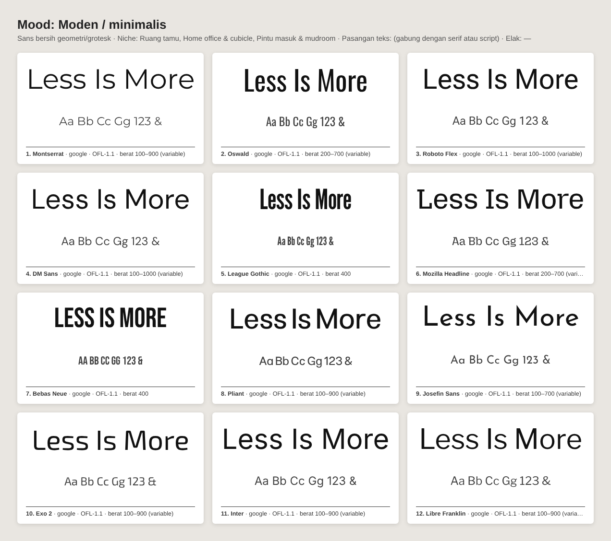

1. [Montserrat](https://fonts.google.com/specimen/Montserrat) · google · OFL-1.1 · ketebalan 100–900 (variable) · kualiti 84
2. [Oswald](https://fonts.google.com/specimen/Oswald) · google · OFL-1.1 · ketebalan 200–700 (variable) · kualiti 84
3. [Roboto Flex](https://fonts.google.com/specimen/Roboto+Flex) · google · OFL-1.1 · ketebalan 100–1000 (variable) · kualiti 83
4. [DM Sans](https://fonts.google.com/specimen/DM+Sans) · google · OFL-1.1 · ketebalan 100–1000 (variable) · kualiti 82
5. [League Gothic](https://fonts.google.com/specimen/League+Gothic) · google · OFL-1.1 · ketebalan 400 · kualiti 82
6. [Mozilla Headline](https://fonts.google.com/specimen/Mozilla+Headline) · google · OFL-1.1 · ketebalan 200–700 (variable) · kualiti 90
7. [Bebas Neue](https://fonts.google.com/specimen/Bebas+Neue) · google · OFL-1.1 · ketebalan 400 · kualiti 81
8. [Pliant](https://fonts.google.com/specimen/Pliant) · google · OFL-1.1 · ketebalan 100–900 (variable) · kualiti 81
9. [Josefin Sans](https://fonts.google.com/specimen/Josefin+Sans) · google · OFL-1.1 · ketebalan 100–700 (variable) · kualiti 62
10. [Exo 2](https://fonts.google.com/specimen/Exo+2) · google · OFL-1.1 · ketebalan 100–900 (variable) · kualiti 78
11. [Inter](https://fonts.google.com/specimen/Inter) · google · OFL-1.1 · ketebalan 100–900 (variable) · kualiti 78
12. [Libre Franklin](https://fonts.google.com/specimen/Libre+Franklin) · google · OFL-1.1 · ketebalan 100–900 (variable) · kualiti 78

Lebih unik (luar Google Fonts): Alpino, Amulya, Author, Bespoke Sans, Bespoke Stencil, Cabinet Grotesk, Chillax, Clash Display

## Futuristik / tekno (152 fon)

Piksel, segmen, sci-fi. Niche: Bilik remaja, Asrama / dorm. Teks pasangan: Inter, Space Grotesk. Elak: Hampir semua niche Gelombang 1.

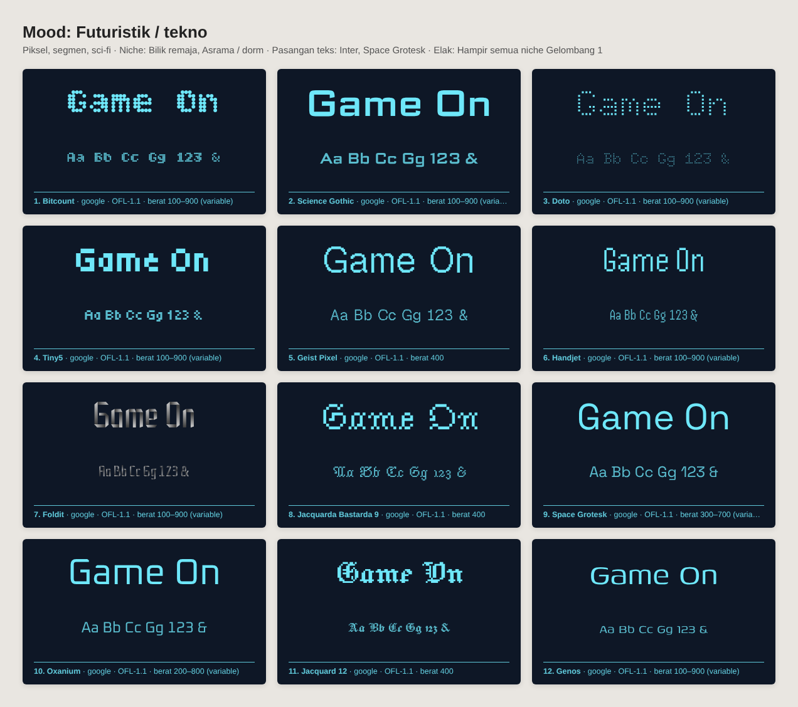

1. [Bitcount](https://fonts.google.com/specimen/Bitcount) · google · OFL-1.1 · ketebalan 100–900 (variable) · kualiti 100
2. [Science Gothic](https://fonts.google.com/specimen/Science+Gothic) · google · OFL-1.1 · ketebalan 100–900 (variable) · kualiti 88
3. [Doto](https://fonts.google.com/specimen/Doto) · google · OFL-1.1 · ketebalan 100–900 (variable) · kualiti 82
4. [Tiny5](https://fonts.google.com/specimen/Tiny5) · google · OFL-1.1 · ketebalan 100–900 (variable) · kualiti 82
5. [Geist Pixel](https://fonts.google.com/specimen/Geist+Pixel) · google · OFL-1.1 · ketebalan 400 · kualiti 100
6. [Handjet](https://fonts.google.com/specimen/Handjet) · google · OFL-1.1 · ketebalan 100–900 (variable) · kualiti 76
7. [Foldit](https://fonts.google.com/specimen/Foldit) · google · OFL-1.1 · ketebalan 100–900 (variable) · kualiti 86
8. [Jacquarda Bastarda 9](https://fonts.google.com/specimen/Jacquarda+Bastarda+9) · google · OFL-1.1 · ketebalan 400 · kualiti 88
9. [Space Grotesk](https://fonts.google.com/specimen/Space+Grotesk) · google · OFL-1.1 · ketebalan 300–700 (variable) · kualiti 76
10. [Oxanium](https://fonts.google.com/specimen/Oxanium) · google · OFL-1.1 · ketebalan 200–800 (variable) · kualiti 69
11. [Jacquard 12](https://fonts.google.com/specimen/Jacquard+12) · google · OFL-1.1 · ketebalan 400 · kualiti 85
12. [Genos](https://fonts.google.com/specimen/Genos) · google · OFL-1.1 · ketebalan 100–900 (variable) · kualiti 61

Lebih unik (luar Google Fonts): Array, Kola, Segment

